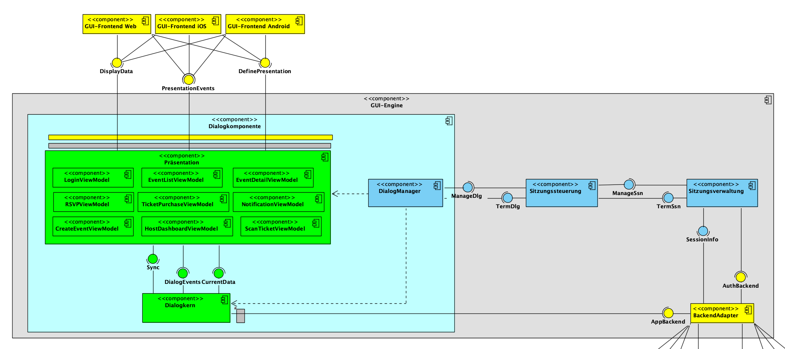

# Architekturentwurf

## Komponentendiagramm

Das folgende Diagramm zeigt den ursprünglichen Architekturentwurf des Happin-Frontends.

Die Frontend-Komponenten folgen dem **Model-View-ViewModel (MVVM)**-Muster und sind in der **GUI-Engine** zusammengefasst, die aus folgenden Schichten besteht:

1. **GUI-Frontends** – plattformspezifische Ausgabe (Web, iOS, Android)
2. **Präsentation** – ViewModels nach MVVM
3. **Dialogkomponenten** – Dialogkern, DialogManager, Sitzungssteuerung/-verwaltung
4. **BackendAdapter** – Kommunikation mit dem Backend

---

## Entwurf vs. Implementierung

### GUI-Frontends

*✅ vollständig umgesetzt*

Die drei Entwurfs-Frontends **GUI-Frontend Web**, **GUI-Frontend iOS** und **GUI-Frontend Android** werden durch **React Native mit Expo** realisiert. Expo ermöglicht einen gemeinsamen Codebase für alle drei Plattformen.

Die Schnittstellen `DefinePresentation` (Ansichten definieren) und `DisplayData` (Dialogobjekte befüllen) entsprechen dem Expo-Router-basierten Dateiensystem unter `app/` kombiniert mit den Screen-Komponenten unter `src/screens/`.

### Präsentation / ViewModels

*✅ vollständig umgesetzt*

Die Präsentationsschicht mit allen ViewModels entspricht dem Verzeichnis `src/screens/`. Jede Screen-Datei ist das konkrete ViewModel im Sinne des MVVM-Musters. Die `PresentationEvents`-Schnittstelle (Rückmeldung an die GUI-Frontends) ist über React-Navigation-Events und State-Updates realisiert.

| Entwurfs-ViewModel | Implementierung | Im Architekturentwurf |
|---|---|---|
| Login-Screen (M1) | `src/screens/LoginScreen.tsx` | [→](<https://gitlab.com/groups/dhbw-se/se-tinf24b2/happin/-/wikis/Entwurf/Komponentendiagramm#:~:text=Umgesetzte%20Anforderungen-,LoginViewModel,-M1%20(Nutzer%2DAuthentifizierung>) |
| Öffentliche Eventliste (M11) | `src/screens/EventListScreen.tsx`, `src/screens/HomeScreen.tsx` | [→](<https://gitlab.com/groups/dhbw-se/se-tinf24b2/happin/-/wikis/Entwurf/Komponentendiagramm#:~:text=und%20Login%2DWorkflow)-,EventListViewModel,-M11%20(%C3%96ffentliche%20Eventliste>) |
| Host Dashboard (M7) | `src/screens/EventHostScreen.tsx` | [→](<https://gitlab.com/groups/dhbw-se/se-tinf24b2/happin/-/wikis/Entwurf/Komponentendiagramm#:~:text=HostDashboardViewModel>) |
| Ticketkauf (S2) | `src/screens/TicketDetailScreen.tsx` (Checkout-Flow) | [→](<https://gitlab.com/groups/dhbw-se/se-tinf24b2/happin/-/wikis/Entwurf/Komponentendiagramm#:~:text=TicketPurchaseViewModel>) |
| RSVP (M5) | `src/screens/EventScreen.tsx` (RSVP-Bereich) | [→](<https://gitlab.com/groups/dhbw-se/se-tinf24b2/happin/-/wikis/Entwurf/Komponentendiagramm#:~:text=S11%20(Meldefunktion)-,RSVPViewModel,-M5%20(RSVP%2DFormular>) |
| Benachrichtigungen | `src/screens/NotificationsScreen.tsx` | [→](<https://gitlab.com/groups/dhbw-se/se-tinf24b2/happin/-/wikis/Entwurf/Komponentendiagramm#:~:text=NotificationViewModel>) |
| Event erstellen | `src/screens/EventCreateStepOneNew.tsx`, `src/screens/EventCreateStepTwo.tsx` | [→](<https://gitlab.com/groups/dhbw-se/se-tinf24b2/happin/-/wikis/Entwurf/Komponentendiagramm#:~:text=CreateEventViewModel>) |
| Ticket scannen | `src/screens/ScanTicketScreen.tsx` | [→](<https://gitlab.com/groups/dhbw-se/se-tinf24b2/happin/-/wikis/Entwurf/Komponentendiagramm#:~:text=Co%2DHost%2DVerwaltung)-,ScanTicketViewModel,-M9%20(QR%2DScanner>) |
| Event-Detail | `src/screens/EventScreen.tsx` | [→](<https://gitlab.com/groups/dhbw-se/se-tinf24b2/happin/-/wikis/Entwurf/Komponentendiagramm#:~:text=EventDetailViewModel>) |
| RSVP-Antworten (Host) | `src/screens/EventRsvpResponsesScreen.tsx` | [→](<https://gitlab.com/groups/dhbw-se/se-tinf24b2/happin/-/wikis/Entwurf/Komponentendiagramm#:~:text=S11%20(Meldefunktion)-,RSVPViewModel,-M5%20(RSVP%2DFormular>) |
| Gäste-Liste (Host) | `src/screens/EventGuestsScreen.tsx` | [→](<https://gitlab.com/groups/dhbw-se/se-tinf24b2/happin/-/wikis/Entwurf/Komponentendiagramm#:~:text=HostDashboardViewModel>) |

### Dialogkern

*✅ umgesetzt – React State statt klassischer Dialogkern*

Der Dialogkern aus dem Entwurf, der bestimmt was dargestellt wird und wie auf Benutzeraktionen reagiert wird, ist in der Implementierung **direkt in die Screen-Komponenten integriert**. Die Schnittstellen `DialogEvents` und `CurrentData` entsprechen den React-Hooks `useState`/`useEffect` sowie den Callback-Funktionen innerhalb der Screens.

!!! note "Abweichung vom Entwurf"
    Ein separates `Dialogkern`-Modul existiert in der Implementierung nicht. React Native und das MVVM-Muster integrieren diese Verantwortlichkeit direkt in die Screen-/ViewModel-Komponenten. Das ist ein gängiger Ansatz in React-Anwendungen, bei dem der Framework-eigene Rendering-Zyklus die Rolle des Dialogkerns übernimmt.

### DialogManager

*✅ umgesetzt – Expo Router*

Der `DialogManager`, der Komponenten bei der Erzeugung eines Dialogs konfiguriert, entspricht dem **Expo Router** (`app/_layout.tsx`). Der Root-Layout richtet den Stack-Navigator ein, registriert alle Screens und verwaltet die Übergänge zwischen ihnen.

### Sitzungssteuerung

*✅ umgesetzt – React Navigation Stack*

[→ Im Architekturentwurf ansehen](<https://gitlab.com/groups/dhbw-se/se-tinf24b2/happin/-/wikis/Entwurf/Komponentendiagramm#:~:text=gr%C3%BCn/rot%2C%20Mehrfachnutzungskontrolle)-,Sitzungssteuerung,-M1%20(Dialoge%20der>)

Die Sitzungssteuerung, die dialogzugehörige Komponenten verwaltet, entspricht dem **React Navigation Stack Navigator**. Er verwaltet den Navigationszustand und die History aller aktiven Screens einer Sitzung.

### Sitzungsverwaltung

*✅ umgesetzt – AuthContext*

[→ Im Architekturentwurf ansehen](<https://gitlab.com/groups/dhbw-se/se-tinf24b2/happin/-/wikis/Entwurf/Komponentendiagramm#:~:text=Co%2DHost%2DSitzung)-,Sitzungsverwaltung,-M1%20(Kenntnis%20aller>)

Die Sitzungsverwaltung, die alle angemeldeten Benutzer kennt, ist als `src/contexts/AuthContext.tsx` umgesetzt. Sie verwaltet die Supabase-Session, den Benutzer und stellt `signOut()` bereit.

### BackendAdapter

*✅ vollständig umgesetzt*

Der `BackendAdapter` ist als `src/services/api.ts` implementiert. Er kapselt alle REST-Aufrufe an das Happin-Backend. Die beiden Entwurfs-Schnittstellen sind wie folgt realisiert:

- **`AuthBackend`** → `src/services/supabase.ts` (Supabase-Client für Auth)
- **`AppBackend`** → `src/services/api.ts` (REST-Client für Anwendungsdaten)

Die API-Schnittstellen aus dem Entwurf (eine je ViewModel) entsprechen den Methoden im `api`-Objekt:

| Entwurfs-API | Methoden in `api.ts` |
|---|---|
| Authentifizierung (M1) | `supabase.ts`: `sendOtp()`, `verifyOtp()` |
| RSVP (M5) | `rsvpEvent()`, `cancelRsvp()` |
| Öffentliche Liste (M11) | `getPublicEvents()` |
| EventInfo | `getEventById()` |
| EventAdmin | `createEvent()`, `updateEvent()`, `cancelEvent()` |
| Ticketing (S2) | `bookTicket()`, `getUserTickets()` |
| HostDashboard | `getHostEvents()`, `getParticipants()` |
| Notifications | `getNotifications()`, `markNotificationRead()` |

---

## Ergänzungen gegenüber dem Entwurf

Folgende Funktionalität wurde implementiert, war aber im ursprünglichen Entwurf nicht explizit vorgesehen:

| Neue Komponente | Begründung |
|---|---|
| `SavedEventsContext.tsx` | Lokales Bookmarking von Events (AsyncStorage) |
| `NotificationsContext.tsx` | In-App-Benachrichtigungszähler mit Polling |
| `ReminderSettingsContext.tsx` | Verwaltung von Push-Erinnerungseinstellungen (K4) |
| `ThemeContext.tsx` | Light/Dark-Theme-Umschaltung (Material Design 3) |
| `src/services/geocoding.ts` | MapTiler-Geocoding direkt im Frontend |
| `src/services/reminders.ts` | Web Push API für Browser-Erinnerungen |
| `constants/berlin-map-paths.ts` | SVG-Visualisierung Berliner Bezirke auf der Karte |
